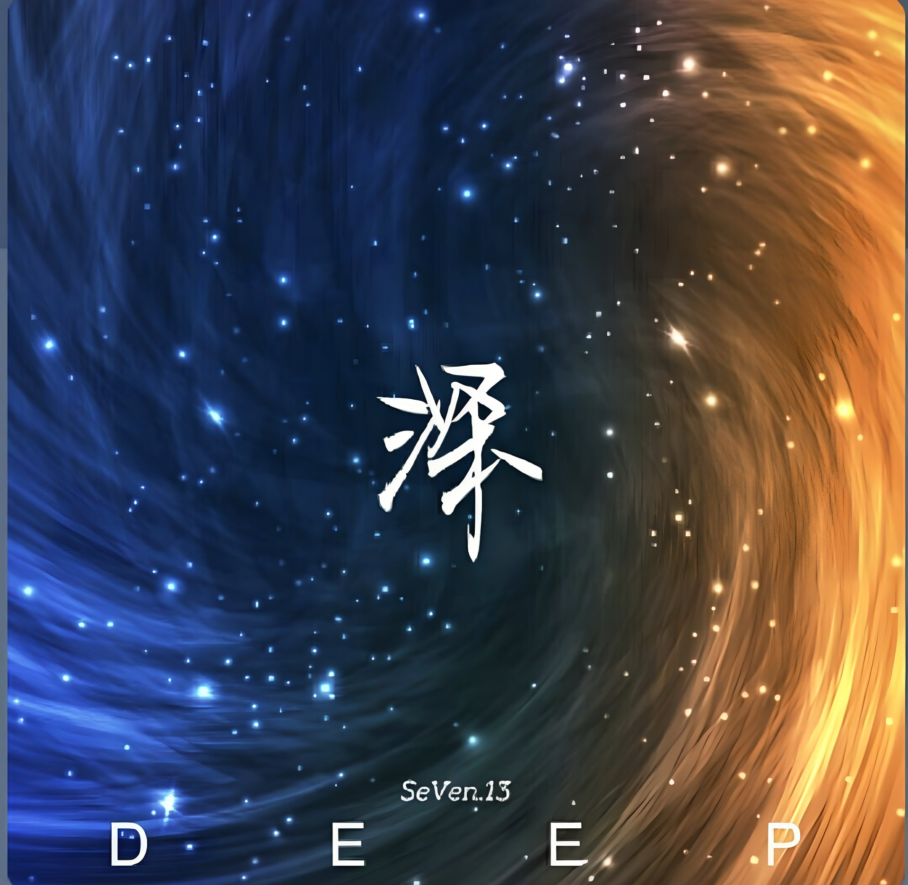

# 02 视觉识别 · 双星体系

## 起点：头像



头像里有四个可用的东西，全部保留，一个都不浪费：

| 元素 | 含义 | 用到哪里 |
|---|---|---|
| 左半冷蓝漩涡 | 混沌、待处理、还在转的事 | 未交作业、未读通知、进行中 |
| 右半暖金漩涡 | 秩序、已归位、沉淀下来的东西 | 已收齐、已归档、已完成 |
| 中央书法「泽」 | 个人印记 | favicon（16px）、水印、加载态 |
| 底部 `D E E P` | 代号 | 仓库名、终端提示符 `deep:~$` |

**取色是从原图采样出来的**，不是凭感觉配的：

```
深空   #0C1D36   深海   #12233C   夜蓝   #15294B
星蓝   #223E83   暗金   #514131   星金   #D38A43
```

## 核心隐喻：双星系统

不是"落叶归位"了，改成**双星轨道**——比落叶更贴你的头像，也更能解释状态：

- 一颗事**在蓝侧环绕**：未交、未读、没排期。它会转，会晃，会提醒你它还在。
- 处理完，它**跃迁到金侧**：安静、变暗、沉底。不是消失，是进入了稳定轨道。
- 整个界面就是这两侧的张力的可视化：左边还剩多少在转，右边已经沉淀了多少。

动效因此只保留两种，别的都不要：

1. **fall**（220ms，`cubic-bezier(.2,.8,.2,1)`）：状态变更时 `translateY(4px)` + 透明度变化，落位即止。不弹跳、不发光、无回弹。
2. **orbit**（8s 匀速）：只在加载态，头像外环旋转一圈。

`prefers-reduced-motion: reduce` 时两种全部关闭。

上面这两条是**功能层**的动效——它们服务于判断，所以必须克制。你想要的华丽效果放在**装饰层**，三层模型见 [09-appearance.md](09-appearance.md) 与 [ADR-0005](decisions/0005-motion-layers.md)：装饰层默认关闭、可选「华丽」包、对账台永久禁入。

## 色板

### 学委端（深空）

| Token | Hex | 用途 |
|---|---|---|
| `--void` | `#070A12` | 页面底。比头像最暗处再压一档，让星点有地方发光 |
| `--deep` | `#0C1D36` | 侧栏、顶栏 |
| `--navy` | `#15294B` | 卡片面 |
| `--blue` | `#223E83` | 卡片描边强调、蓝侧轨道 |
| `--signal` | `#4C7BE0` | 链接、焦点环、唯一可点击色（提亮过，保证 4.5:1） |
| `--gold` | `#D38A43` | 主强调：已收齐、归档、主要按钮 |
| `--amber` | `#E9A341` | 数字、计时、需要你注意但还不致命 |
| `--red` | `#E2603F` | **只给真正的 DDL 危机**。全站只允许一处红 |
| `--paper` | `#F2EDE4` | 主文字 |
| `--dim` | `#8C97A8` | 次要文字 |
| `--mute` | `#55606F` | 禁用、已归档 |

规则：
- 金色只用在「已经完成/已经归位」和「主操作」；蓝色只用在「还在转」和「可点」。
- 红色稀缺性是这个产品最重要的视觉纪律。一旦哪儿都红，它就失效了。
- 不用渐变铺底。头像那张图已经够华丽，界面必须让位。

### 学生端（纸白）

| Token | Hex | 用途 |
|---|---|---|
| `--sheet` | `#F7F4EE` | 底 |
| `--ink` | `#1A1F2A` | 正文 |
| `--ink-dim` | `#6B7280` | 次要 |
| `--line` | `#E2DCD1` | 分隔线 |
| `--gold-ink` | `#B4762C` | 强调（浅底上把金色压深，保证对比度） |

学生端**不用深色**。它出现在教室、食堂、宿舍的强光下，也出现在不想被同学看到手机屏幕的场合——浅色更像"取件柜"，不像"黑客工具"。

## 字体

| 用途 | 字体 | 理由 |
|---|---|---|
| 拉丁 / 数字 | JetBrains Mono → Consolas | 等宽，`tabular-nums`，时间与人数对齐 |
| 中文 | Sarasa Mono SC（更纱黑体）→ 思源黑体 → 系统黑体 | 唯一一个中文等宽字体家族，极客味最正 |
| 学生端 | 系统黑体（-apple-system / PingFang / YaHei） | 同学不该看到任何需要"装字体"的东西 |

- 字号阶梯：11 / 12 / 13 / 15 / 20 / 28。**不用 14 和 16**，避免视觉上分不清层级。
- 字重只有 400 和 500。极客感不靠加粗，靠等宽和对齐。
- 中文标题 `letter-spacing: .02em`，拉丁标题 `-.01em`。

## 图形语言

| 元素 | 用法 |
|---|---|
| `deep:~$` | 只出现在两处：命令面板、空状态。多了就腻 |
| `[ 数据结构 ]` | 可点击的课程标签用方括号；纯文字不加 |
| `●` `◐` `○` | 未处理 / 疑似 / 已完成。**用符号而不是彩点**，色弱也能读 |
| 轨道环 | 头像外一圈 1px 椭圆，hover 时 8s 转一圈 |
| 点阵 | 24px 网格 1px 点，只铺在空状态和大块留白上，透明度 6% |
| 1px 细线 | 所有分隔。圆角上限 8px，卡片用 8px，格子用 4px |

**禁用清单**：阴影、外发光、玻璃拟态、>8px 圆角、多层渐变、emoji 图标、彩色渐变按钮。

## 命名与标识

| 项 | 值 |
|---|---|
| 中文名 | 拾课 |
| 代号 | DEEP（取自头像底部） |
| 仓库名 | `deep` |
| 终端提示符 | `deep:~$` |
| 锁版 | `DEEP` 字距 0.4em + 下面一行小字 `拾课 · ShenFall 学委工作台` |
| Logo | **头像就是 logo**，裁成圆形加 1px `--gold` 环，不另画 |
| Favicon | 16px 下头像会糊，退化为单字「泽」，白字深底 |
| 英文口号 | Everything falls into place. |

## 两套皮肤对照

| 维度 | 终端（学委） | 取件柜（学生） |
|---|---|---|
| 底色 | `#070A12` | `#F7F4EE` |
| 字体 | 等宽 | 系统黑体 |
| 信息密度 | 高（一屏 40 人 + 时间轴 + 队列） | 低（一屏 6 个文件） |
| 输入方式 | 键盘优先，`⌘K` 命令面板 | 纯触摸，点击区 ≥ 44px |
| 目标 | 3 秒做一个决定 | 3 步拿到一个文件 |
| 出错代价 | 漏掉一个人 | 找不到一份文件 |

**一个系统，两套壳。** 这是整个项目最值得坚持的结构性判断：不要试图用一套 UI 同时讨好两种人。
