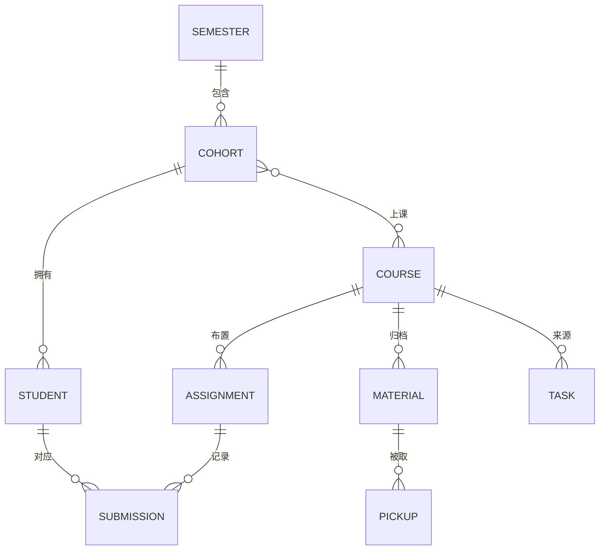

# 04 数据模型

## 实体关系



关系说明：

- `COHORT`（班级）和 `COURSE`（课程）是**多对多**。同一个班上一门课，一门课也可能带两个班。这是为了「换班级后继续用」和「跨学期复用课程」。
- `STUDENT` 永远挂在某个 `COHORT` 下，不直接挂课程。作业、资料都通过课程间接关联。
- `SUBMISSION` 是「某学生 × 某次作业」的状态记录，不是文件本身。文件在哪不重要（群里、网盘、纸质），系统只记状态。

## 核心实体字段

### Cohort 班级

| 字段 | 类型 | 说明 |
|---|---|---|
| `id` | string | `c_2024cs01` |
| `name` | string | 展示名：2024 级计科 1 班 |
| `semester` | string | `2026-fall`，用于归档 |
| `studentCount` | number | 派生值，不存 |
| `archived` | boolean | 换班后旧班级不删，置为归档 |

### Student 学生

| 字段 | 类型 | 说明 |
|---|---|---|
| `id` | string | `s_<cohort>_<seq>`，内部主键，永不变 |
| `sid` | string? | 学号，可空但强烈建议填 |
| `name` | string | 姓名 |
| `pinyin` | string | 自动生成，`linjiahe`，用于搜索 |
| `initials` | string | `ljh`，用于首字母跳转 |
| `group` | string? | 组号/行政组 |
| `aliases` | Alias[] | 微信昵称、群接龙里的错字、文件名里的写法 |
| `note` | string? | 备注：转专业、休学 |
| `active` | boolean | 软删除，不物理删（历史作业还要指向他） |

### Alias 别名（关键设计）

| 字段 | 类型 | 说明 |
|---|---|---|
| `value` | string | `一只眠羊`、`Lin Jiahe`、`嘉禾` |
| `source` | enum | `manual` / `learned` / `wechat` |
| `confidence` | number | 手工加的是 1.0，系统学到的从 0.8 起 |

**为什么需要别名表**：微信昵称和真名往往毫无关系（`一只眠羊` ↔ `林嘉禾`）。系统每匹配成功一次，就把那个写法记进别名表，下次直接命中。这是这个产品会「越用越准」的唯一机制。

### Assignment 作业

| 字段 | 类型 | 说明 |
|---|---|---|
| `id` | string | `a_<course>_04` |
| `courseId` | string | |
| `cohortId` | string | 哪套花名册 |
| `title` | string | 第 4 次作业 |
| `dueAt` | ISO8601 | 绝对时间，必须带时区 |
| `dueText` | string? | 老师原话：「下周三之前」 |
| `requiresPaper` | boolean | 要交纸质版 |
| `status` | enum | `open` / `reconciling` / `closed` |
| `sourceText` | string? | 原始通知，用于回溯 |

### Submission 提交状态

| 字段 | 类型 | 说明 |
|---|---|---|
| `assignmentId` | string | |
| `studentId` | string | |
| `state` | enum | `unpaid` / `paid` / `suspect`（`suspect` 只在批量补录路径短暂存在） |
| `submittedAt` | ISO8601 | 标记时间。流式收作业时每次标记自动打，期末算超时用 |
| `matchedBy` | enum | `drop` / `cli` / `paste` / `import` / `manual` |
| `evidence` | string? | 匹配到的原始字符串，比如那次接龙里的「李梓衿」 |
| `updatedAt` | ISO8601 | |

**主路径两态，补录路径三态。** 流式收作业时，每次标记背后都有一个具体的人为动作（拖了个文件、敲了个名字），匹配不上就当场问「这是谁」，所以不需要持久化的中间态。只有批量补录（粘贴 20 个名字）时，才会出现「不确定这是谁」的悬空记录，这时用 `suspect` 单独列出来等你一句话——**系统不确定时不撒谎**，没有这个状态，批量补录就会悄悄漏人。

### Material 资料

| 字段 | 类型 | 说明 |
|---|---|---|
| `id` | string | |
| `courseId` | string | |
| `title` | string | 清洗后的标题 |
| `chapter` | string? | 章节/周次 |
| `kind` | enum | `slides` / `outline` / `exam` / `reference` / `other` |
| `storageKey` | string | 对象存储 key |
| `size`, `mime`, `pages` | | 展示用 |
| `visibility` | enum | `draft` / `public` / `passcode` / `archived` |
| `slug` | string | 8 位随机，`noindex` |
| `expiresAt` | ISO8601? | 学期末 +7 天自动下线 |
| `pickupCount` | number | 只记次数，不记人 |

## 花名册导入规范

### 支持的输入

| 方式 | 说明 | 优先级 |
|---|---|---|
| **xlsx / xls** | **主格式**。教务系统导出的原始文件直接扔进来 | P0 |
| CSV / TSV | 兼容项。Excel 另存的 CSV 常是 GBK，需编码嗅探 | P1 |
| 粘贴文本 | 微信里复制的名单，按行解析 | P1 |
| 截图 OCR | 教务系统只给截图时 | P2 |

**为什么 xlsx 是主格式**：它一次解决三件事——不用管编码（内部是 UTF-8 的 XML）、能读 .xls 旧格式、能拿到 sheet 结构与合并区域信息。CSV 反而要额外处理 GBK。

### Excel 的五个坑（每一个都会真的遇到）

| 坑 | 现象 | 处理 |
|---|---|---|
| **学号被当成数字** | 显示成 `1.20241E+11`，或末尾几位变 0 | 一律按字符串读；检测到 `\d\.\d+E\+\d+` 直接拦下，提示「学号列被 Excel 转成数字了，请把该列设为文本格式后重新导出」 |
| **合并单元格** | 只有左上角有值，下面几行是空 | 读 merge 区域，向下前向填充 |
| **表头不在第一行** | 前 3 行是「XX大学XX学院2024级学生名单」 | 扫前 10 行找含「姓名 / 学号 / 学生」的行；找不到就让你手动点一行 |
| **多个 sheet** | 第一个 sheet 是封面或说明 | 列出所有 sheet + 行数，默认选行数最多的，可手切 |
| **姓名带杂质** | `张 三`、`张三(转专业)`、`张三 ` | 全角空格转半角、去括号备注、trim |

导入成功后立即为每个人生成拼音索引（`pinyin-pro`），40 人耗时 <10ms，存进 `student.pinyin` 与 `student.initials`。

### 列识别

按表头自动识别，识别不到让你手动指一次，并记住这个映射：

| 目标字段 | 可识别的表头写法 |
|---|---|
| 姓名 | 姓名、学生姓名、名字、name |
| 学号 | 学号、学号/工号、student id、sid |
| 微信 | 微信、昵称、微信名、wechat |
| 分组 | 组、组号、行政班、分组 |

### 导入预览（必须经过这一步）

三类着色，跟对账台用同一套语义：

- **绿（可导入）**：姓名 + 学号齐全且无冲突
- **黄（需确认）**：缺学号、同班重名、疑似重复
- **红（无法解析）**：姓名为空、整行乱码

重名处理：两个「张伟」不允许直接导入，必须补学号或用微信昵称区分，否则后面的对账永远是对不准的。

### 换班级怎么继续用

1. 新建 `Cohort`，选学期，导入新花名册 → 3 分钟。
2. 旧班级标 `archived`，历史作业、资料、统计全部保留，可随时切回去看。
3. 课程可以从上学期「克隆」：只带结构和资料，不带学生和提交记录。

**绝不覆盖**：同一学期同一班级重复导入，走「合并」而不是「替换」——按学号对齐，新增的加进去，消失的标 `inactive`（可能是转专业），让你确认一次。

## 姓名匹配算法

输入是一条脏字符串（`1. 李梓衿`、`林嘉禾-副本(1).pdf`、`一只眠羊`），输出是 `{ studentId | null, confidence, method }`。

```
0. 归一化
   - 全角转半角、去空格、去序号前缀（1. / ① / - ）
   - 去文件后缀、去「-副本」「(1)」「最终版」
   - 繁转简
1. 精确命中（confidence 1.0）
   学号 → 姓名 → 别名表
2. 别名反查（0.95）
   历史学过的写法
3. 拼音命中（0.9）
   全拼相等 / 首字母相等且长度一致
4. 模糊（0.4–0.85）
   Levenshtein ≤ 2 且两字姓名严格相等 → suspect
   同音字（梓/子、琪/琦、涵/晗）→ suspect
5. 都对不上 → unmatched，进「未知」桶，等你手工指派
```

阈值：`≥0.9` 直接判 `paid`，`0.4–0.9` 判 `suspect`，其余 `unmatched`。所有 `suspect` 必须人工确认一次才转为 `paid`——这一条不许为了省事放宽。

匹配率低于 60% 时不弹「成功」，直接提示：「这次只认出一半，是不是花名册里没这个班？」——错误要被说出来，不能被平均掉。
